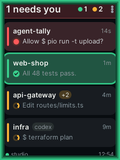
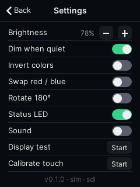

# AgentTally

[](https://github.com/ibrahim-dogan/agent-tally/actions/workflows/build.yml)

**A tiny desk display that tells you when your AI coding agents need you.**

AgentTally turns a ~$15 ESP32 "Cheap Yellow Display" into a live monitor for every Claude Code session on your computer: which ones are working, which are blocked waiting for your approval or answer, and which have finished their turn. It comes with firmware, a browser flasher, a tiny host bridge and a 3D-printable portrait stand that hides the cable.


- **Live session list.** Sessions waiting for you float to the top and pulse red. Finished turns turn green until you look at them. The rest show the tool they are running (`Edit routes.ts`, `$ npm test`, `Agent: Explore` ...).
- **Alerts on the screen.** When a session starts waiting for you or finishes, the edge of the screen pulses red or green three times and that session's card glows with it.
- **Detail view.** Tap a session to see its folder, the current step, your last prompt and the start of Claude's last reply.
- **Focus button (macOS).** In the detail view, *Focus* brings that session's terminal tab to the front on your Mac.
- **Use your mouse on it (macOS).** Push the pointer off the bottom edge of your screen and it moves onto the display.
- **Night mode.** Screen and LED switch off between 22:00 and 09:00 (configurable). A touch shows the screen for 30 seconds.
- **USB only.** No Wi-Fi setup, no cloud. Everything stays on your machine and on the cable.
- **Other agents.** Claude Code works out of the box through hooks. Codex CLI and anything that can run a command or send an HTTP request can report too.
- **Runs in a simulator.** The same UI code builds as a desktop SDL app, so you can try it without hardware.

## Quick start

| | |
|---|---|
| 1. **Flash** | Open the [web flasher](https://ibrahim-dogan.github.io/agent-tally/) in Chrome or Edge on a desktop, pick your board, press *Install*. |
| 2. **Install the bridge** | `curl -fsSL https://raw.githubusercontent.com/ibrahim-dogan/agent-tally/main/host/install.sh \| sh` |
| 3. **Print the stand** | STL files in [`enclosure/stl`](enclosure/stl), details in [`enclosure/README.md`](enclosure/README.md). |

Restart your Claude Code sessions after installing the bridge. Run `agenttally status` to see what the bridge knows.

The installer copies the bridge to `~/.agent-tally/` and links it as `~/.local/bin/agenttally`. If that folder is not on your `PATH`, use `python3 ~/.agent-tally/agenttally.py` wherever this page says `agenttally`.

## Status: what is tested

This is a first release, built and used on one setup.

| | |
|---|---|
| **Tested** | The 2.8" dual-USB board ("CYD2USB", ESP32-2432S028R with an ST7789 panel), its 2.8" stand, Claude Code on macOS with the bridge running under launchd. |
| **Untested, best effort** | All other boards (their firmware builds in CI but is untested on hardware), the 3.5" stand (estimated dimensions), the bridge on Linux (systemd user unit) and Windows (no installer or autostart; run `serve` yourself with `pyserial` installed), the Codex CLI integration. |
| **macOS only** | The Focus button, the mouse on the display, and the launchd service. |
| **Experimental** | A light pipe that carries the rear LED to the front of the stand (separate bezel and rear cover with a slot, see [enclosure/README.md](enclosure/README.md)). It works, but the light is weak. Rely on the red/green frame on the screen. |

Reports from other boards and systems are welcome, see [Contributing](#contributing).

## How it works

```
 Claude Code ──hooks──▶ curl ──HTTP──▶ agenttally.py ──USB serial──▶ CYD display
 Codex / scripts ─────────────────────▶  (127.0.0.1:47321)      └─TCP─▶ desktop simulator
```

1. The installer adds a hook entry for each relevant Claude Code event (`UserPromptSubmit`, `PreToolUse`, `PermissionRequest`, `Notification`, `Stop`, `SessionEnd`, ...) to `~/.claude/settings.json`. Each hook pipes the event JSON to the bridge with `curl`. A backup of the settings file is saved first.
2. `agenttally.py` (Python 3.8+, standard library only) turns events into a session list and keeps it in `~/.agent-tally/state.json`. It runs at login through launchd (macOS) or a systemd user unit (Linux).
3. The bridge finds the display by its USB-serial chip, opens the port without toggling DTR/RTS (which would reset the ESP32) and streams newline-delimited JSON. See [docs/PROTOCOL.md](docs/PROTOCOL.md).
4. The firmware draws with LovyanGFX into a double-buffered band (40 rows at a time) pushed by DMA, using anti-aliased Inter fonts that cover Latin-1 and Latin Extended-A (ç ğ ı ö ş ü ä ß é ...).

### What the states mean

| State | Shown when | Claude Code events |
|---|---|---|
| **Needs you** (red) | Claude is blocked on you | `PermissionRequest`, `Notification` with `permission_prompt` / `elicitation_dialog`, `AskUserQuestion`, `ExitPlanMode` |
| **Done** (green) | The turn finished and you haven't looked yet | `Stop` (shows the first sentence of the reply) |
| **Working** (amber) | Claude is thinking or running tools | `UserPromptSubmit`, `PreToolUse`, `PostToolUse`, `PreCompact` |
| **Idle** (grey) | Started, interrupted, or done for more than 30 minutes | `SessionStart`, Esc (detected from the transcript) |

A session disappears on `SessionEnd`, or when its `claude` process exits.

### Alerts



When a session starts waiting for you, or finishes its turn, three things pulse together, three times:

- a frame along the edge of the screen, red for *needs you* and green for *done* (switch it off with *Flash on alerts*),
- the card of the session that raised the alert,
- the RGB LED on the back of the board.

After that the LED keeps showing the overall state: breathing red while something needs you, steady green while a finished turn is unseen, slow amber while agents work. The LED faces backwards, so on its own you mostly see its glow on the wall. The stand's light pipe brings a little of it to the front, but it is experimental and weak. The frame on the screen is the alert to rely on.

With a speaker on the board's 2-pin connector and *Sound* switched on, the display also beeps.

<br clear="right">

### Session names

A Claude Code session is listed under the same name as its terminal tab: the title you gave it with `/rename`, otherwise the title Claude Code generated for the session, otherwise the folder name. The name follows later changes.

## Hardware

| Board | Status |
|---|---|
| ESP32-2432S028R 2.8", dual USB (micro-USB + USB-C, "CYD2USB") | Tested (ST7789 panel) |
| ESP32-2432S028R 2.8", single micro-USB | Same firmware, ILI9341 / ST7789 detected at boot. Untested |
| ESP32-3248S035R / C 3.5" | Builds, untested (help welcome) |
| ESP32-2432S032R / C 3.2" | Builds, untested |
| ESP32-2432S024R / C 2.4" | Builds, untested |

Pins, panel quirks and dimensions are collected in [docs/HARDWARE.md](docs/HARDWARE.md).

## Other agents

Anything can push state to the bridge:

```sh
agenttally send --source codex --id my-run --state working --title infra --detail "terraform plan"
agenttally send --source codex --id my-run --state done
agenttally send --source codex --id my-run --state ended   # remove it
```

or over HTTP (the bridge only accepts JSON bodies, so the `Content-Type` header is required):

```sh
curl -X POST -H 'Content-Type: application/json' localhost:47321/api/event \
  -d '{"source":"aider","id":"1","state":"waiting","title":"api","detail":"Approve the diff?"}'
```

**Codex CLI.** Add this to `~/.codex/config.toml` to get a green *done* card whenever a Codex turn finishes:

```toml
notify = ["python3", "/Users/you/.agent-tally/agenttally.py", "codex-notify"]
```

Codex only reports finished turns this way, and this path is untested.

## Focus a session's terminal (macOS)

Open a session on the display and tap *Focus* in the top-right corner: the bridge brings that session's terminal to the front.

- In iTerm2 and Terminal.app it selects the exact tab the session runs in.
- For other terminals and IDEs it brings the app to the front.
- For a Claude Code background session it switches to the tab attached to it, or opens a new tab with `claude attach`.

The button only appears when the bridge runs on macOS and knows the session's process, which is the case for Claude Code sessions. The first time, macOS asks whether the bridge may control your terminal app; if you decline, the button answers *allow automation*.

## Use the Mac mouse on the display (macOS)

Push the mouse against the bottom edge of the main screen (its left quarter by default) and it moves onto the display, like a second screen: click to tap, hold and drag to scroll, the wheel scrolls the list, a right click goes back. Move up past the display's top edge, press Esc or Cmd-Tab to return.

It needs no Accessibility or Input Monitoring permission: a small helper (`host/pointer.swift`, compiled on first use with the Xcode command line tools) freezes and hides the cursor the way games do and reads the movement from events sent to its own window.

It is on by default while a display is connected. Tune it or switch it off:

```sh
agenttally pointer status
agenttally pointer on --start 0.0 --length 0.25 --speed 0.8   # edge zone start and width (0..1 of the screen width), speed
agenttally pointer off
```

## Device settings

Long-press the header, or tap the ⋮ icon in the top-right corner, to open the settings screen:

- Brightness and *Dim when quiet* (dims after a few minutes without activity)
- Invert colours, rotate 180°
- *Flash on alerts* (the frame), *Status LED* and *Sound* (needs a speaker on the 2-pin connector)
- *Sleep* (night mode on or off)
- A colour test screen and touch calibration



The same settings, plus a few that are not on the screen (gamma curve, swap red/blue, panel driver, the night hours), are available from the computer and from the *Device tools* section of the [web flasher](https://ibrahim-dogan.github.io/agent-tally/):

```sh
agenttally device brightness=120 gamma=2
agenttally device sleep_from=23 sleep_to=7      # night hours, whole hours, local time
agenttally device sleep=0                       # no night mode
```

All keys are listed in [docs/PROTOCOL.md](docs/PROTOCOL.md).

**Night mode.** Between 22:00 and 09:00 by your computer's clock the screen and the LED are off. Touch the screen (or move the mouse onto it) to see it for 30 seconds. It is on by default.

## Development

```sh
# host bridge
python3 -m unittest host/test_agenttally.py
python3 host/agenttally.py serve -v               # foreground, verbose
python3 host/agenttally.py demo                   # add five fake sessions (demo --clear removes them)

# firmware (PlatformIO)
cd firmware
pio run -e cyd28 -t upload                        # stop the bridge first: agenttally service stop
pio run -e sim && .pio/build/sim/program          # SDL simulator, connects to the bridge on :47322

# everything for the web flasher, screenshots and STLs
tools/build_firmware.sh && tools/screenshots.sh && enclosure/render.sh && tools/build_site.sh
```

The simulator needs SDL2 (`brew install sdl2` or `apt install libsdl2-dev`). It accepts `--tap x,y@ms` and `--shot file.ppm@ms`, which `tools/screenshots.sh` uses to render the screenshots in `docs/img` against a throwaway bridge (`tools/screenshots.sh 320 480` for the 3.5" layout).

**Recording a demo.** `agenttally demo-mode on` hides your real sessions from the display and plays a scripted loop of made-up ones instead, with `studio` in the footer instead of your computer's name (`--host NAME` changes it). `agenttally demo-mode off` brings the real sessions back.

## Troubleshooting

- **Colours look washed out or bluish (2.8" dual-USB board).** These boards use a TN panel. Try another gamma curve in *Device tools* or with `agenttally device gamma=1..4`. The default for ST7789 boards is curve 2. Also check the viewing angle: the stand tilts the screen back 15° to match the panel.
- **Garbled picture.** Force the panel driver: `agenttally device panel=1` (ILI9341) or `panel=2` (ST7789). The board restarts.
- **Touch is off.** Settings → *Calibrate touch*.
- **"port busy" when flashing.** The bridge holds the serial port. The web flasher asks a running bridge to let go of it during the install. For `pio run -t upload` or esptool, stop the bridge first with `agenttally service stop` and start it again with `agenttally service start`.
- **The screen is black in the evening.** That is night mode, see [Device settings](#device-settings).
- **Nothing shows up.** `agenttally status` lists the devices and sessions the bridge knows. The log is in `~/.agent-tally/bridge.log` (macOS). Hooks are only active in folders where you accepted Claude Code's workspace trust dialog.

## Privacy

The bridge only listens on `127.0.0.1`. Session names, folders, your last prompt and the start of Claude's last reply are shown on the display, so keep that in mind on a shared desk. Nothing leaves your computer.

## Uninstall

```sh
agenttally uninstall    # removes the hooks and the autostart service
rm -rf ~/.agent-tally
```

## Contributing

Bug reports, test reports from other boards or operating systems, and pull requests are welcome: [open an issue](https://github.com/ibrahim-dogan/agent-tally/issues). For a board report, please include the board name printed on the PCB and the output of `agenttally status`.

## License

Firmware, bridge and web flasher: [MIT](LICENSE). Enclosure: [CC BY 4.0](enclosure/LICENSE). Inter font: [SIL OFL 1.1](firmware/tools/fonts/OFL.txt).

AgentTally is an independent project and is not affiliated with Anthropic or Sunton.
