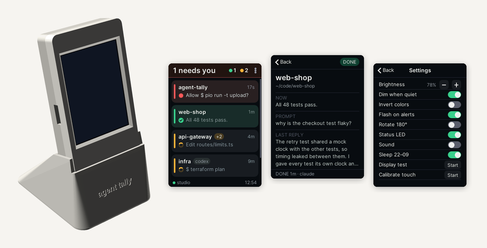

# AgentTally

**A tiny desk display that tells you when your AI coding agents need you.**

AgentTally turns a ~$15 ESP32 "Cheap Yellow Display" into a live monitor for every Claude Code session on your computer: which ones are working, which are blocked waiting for your approval or answer, and which have finished their turn. It comes with firmware, a browser flasher, a tiny host bridge and a 3D-printable portrait stand that hides the cable.



- **Live session list.** Sessions waiting for you float to the top and pulse red. Finished turns turn green until you look at them. The rest show the tool they are running (`Edit routes.ts`, `$ npm test`, `Agent: Explore` ...).
- **Detail view.** Tap a session to see its folder, the current step, your last prompt and the start of Claude's last reply.
- **Status light.** The RGB LED on the back breathes red when something needs you, glows green when a turn is done and amber while agents work. A printed light pipe brings it to a light bar on the front of the stand.
- **USB only.** No Wi-Fi setup, no cloud. Everything stays on your machine and on the cable.
- **Any agent.** Claude Code works out of the box through hooks. Codex CLI and anything that can run a command or send an HTTP request can report too.
- **Runs in a simulator.** The same UI code builds as a desktop SDL app, so you can try it without hardware.

## Quick start

| | |
|---|---|
| 1. **Flash** | Open the [web flasher](https://ibrahim-dogan.github.io/agent-tally/) in Chrome or Edge, pick your board, press *Install*. |
| 2. **Install the bridge** | `curl -fsSL https://raw.githubusercontent.com/ibrahim-dogan/agent-tally/main/host/install.sh \| sh` |
| 3. **Print the stand** | STL files in [`enclosure/stl`](enclosure/stl), details in [`enclosure/README.md`](enclosure/README.md). |

Restart your Claude Code sessions after installing the bridge. Run `python3 ~/.agent-tally/agenttally.py status` to see what the bridge knows.

## How it works

```
 Claude Code ──hooks──▶ curl ──HTTP──▶ agenttally.py ──USB serial──▶ CYD display
 Codex / scripts ─────────────────────▶  (127.0.0.1:47321)      └─TCP─▶ desktop simulator
```

1. The installer adds a hook entry for each relevant Claude Code event (`UserPromptSubmit`, `PreToolUse`, `PermissionRequest`, `Notification`, `Stop`, `SessionEnd`, ...) to `~/.claude/settings.json`. Each hook pipes the event JSON to the bridge with `curl`. A backup of the settings file is saved first.
2. `agenttally.py` (Python 3.8+, standard library only) turns events into a session list and keeps it in `~/.agent-tally/state.json`. It runs at login through launchd (macOS) or a systemd user unit (Linux).
3. The bridge finds the display by its USB-serial chip, opens the port without toggling DTR/RTS (which would reset the ESP32) and streams newline-delimited JSON. See [docs/PROTOCOL.md](docs/PROTOCOL.md).
4. The firmware draws with LovyanGFX into a double-buffered band (40 rows at a time) pushed by DMA, using anti-aliased Inter fonts that cover Latin-1 and Latin Extended-A (ç ğ ı ö ş ü ä ß é ...).

### What the states mean

| State | Shown when | Claude Code events |
|---|---|---|
| **Needs you** (red) | Claude is blocked on you | `PermissionRequest`, `Notification` with `permission_prompt` / `elicitation_dialog`, `AskUserQuestion`, `ExitPlanMode` |
| **Done** (green) | The turn finished and you haven't looked yet | `Stop` (shows the first sentence of the reply) |
| **Working** (amber) | Claude is thinking or running tools | `UserPromptSubmit`, `PreToolUse`, `PostToolUse`, `PreCompact` |
| **Idle** (grey) | Started, interrupted, or done for more than 30 minutes | `SessionStart`, Esc (detected from the transcript) |

A session disappears on `SessionEnd`, or when its `claude` process exits.

## Hardware

| Board | Status |
|---|---|
| ESP32-2432S028R 2.8" (micro-USB, and dual micro-USB + USB-C) | Tested. ILI9341 / ST7789 detected at boot |
| ESP32-3248S035R / C 3.5" | Builds, untested (help welcome) |
| ESP32-2432S032R / C 3.2" | Builds, untested |
| ESP32-2432S024R / C 2.4" | Builds, untested |

Pins, panel quirks and dimensions are collected in [docs/HARDWARE.md](docs/HARDWARE.md).

## Other agents

Anything can push state to the bridge:

```sh
agenttally.py send --source codex --id my-run --state working --title infra --detail "terraform plan"
agenttally.py send --source codex --id my-run --state done
agenttally.py send --source codex --id my-run --state ended   # remove it
```

or over HTTP:

```sh
curl -X POST localhost:47321/api/event -d '{"source":"aider","id":"1","state":"waiting","title":"api","detail":"Approve the diff?"}'
```

**Codex CLI.** Add this to `~/.codex/config.toml` to get a green *done* card whenever a Codex turn finishes:

```toml
notify = ["python3", "/Users/you/.agent-tally/agenttally.py", "codex-notify"]
```

## Device settings

Long-press the header, or tap the ⋮ icon in the top-right corner, to open the settings screen:

- Brightness and dim when quiet
- Invert colours, swap red/blue, rotate 180°
- Status LED and sound (needs a speaker on the 2-pin connector)
- A colour test screen and touch calibration

The same settings are available from the computer (`agenttally.py device brightness=120 gamma=2`) and from the *Device tools* section of the web flasher.

## Development

```sh
# host bridge
python3 -m unittest host/test_agenttally.py
python3 host/agenttally.py serve -v               # foreground, verbose
python3 host/agenttally.py demo                   # fake sessions

# firmware (PlatformIO)
cd firmware
pio run -e cyd28 -t upload                        # stop the bridge first: agenttally.py service stop
pio run -e sim && .pio/build/sim/program          # SDL simulator, connects to the bridge on :47322

# everything for the web flasher, screenshots and STLs
tools/build_firmware.sh && tools/screenshots.sh && enclosure/render.sh && tools/build_site.sh
```

The simulator needs SDL2 (`brew install sdl2` or `apt install libsdl2-dev`). It accepts `--tap x,y@ms` and `--shot file.ppm@ms`, which `tools/screenshots.sh` uses to render the images in this README.

## Troubleshooting

- **Colours look washed out or bluish (2.8" dual-USB board).** These boards use a TN panel. Try another gamma curve in *Device tools* or with `agenttally.py device gamma=1..4`. The default for ST7789 boards is curve 2. Also check the viewing angle: the stand tilts the screen back 15° to match the panel.
- **Garbled picture.** Force the panel driver: `agenttally.py device panel=1` (ILI9341) or `panel=2` (ST7789). The board restarts.
- **Touch is off.** Settings → *Calibrate touch*.
- **"port busy" when flashing.** The bridge holds the serial port. Stop it with `agenttally.py service stop`.
- **Nothing shows up.** `agenttally.py status` lists the devices and sessions the bridge knows. The log is in `~/.agent-tally/bridge.log`. Hooks are only active in folders where you accepted Claude Code's workspace trust dialog.

## Privacy

The bridge only listens on `127.0.0.1`. Session names, folders, your last prompt and the start of Claude's last reply are shown on the display, so keep that in mind on a shared desk. Nothing leaves your computer.

## Uninstall

```sh
python3 ~/.agent-tally/agenttally.py uninstall    # removes the hooks and the autostart service
rm -rf ~/.agent-tally
```

## License

Firmware, bridge and web flasher: [MIT](LICENSE). Enclosure: [CC BY 4.0](enclosure/LICENSE). Inter font: [SIL OFL 1.1](firmware/tools/fonts/OFL.txt).

AgentTally is an independent project and is not affiliated with Anthropic or Sunton.
