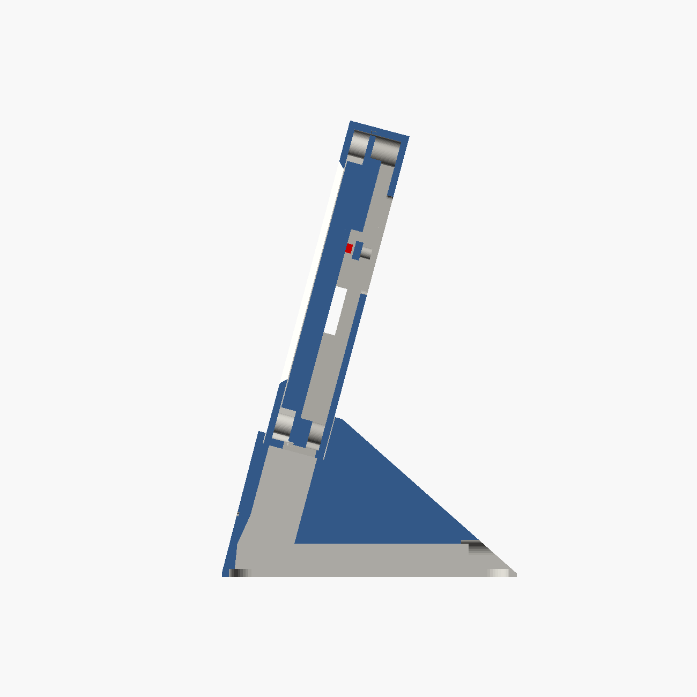

# AgentTally stand

A portrait case and desk stand for the 2.8" Cheap Yellow Display (ESP32-2432S028R, both the micro-USB and the dual-USB version). The screen leans back 15°, and the USB plug and cable hide inside the foot.

 

## Parts

| File | Print orientation | Notes |
|---|---|---|
| `stl/agenttally-cyd28-front.stl` | face down | bezel with the screen window |
| `stl/agenttally-cyd28-back.stl` | outside down | rear cover, vents let the RGB LED glow through |
| `stl/agenttally-cyd28-stand.stl` | upright | ≥30% infill: the weight keeps it from tipping when you press the resistive screen |
| `stl/agenttally-cyd28-plate.stl` | flat | closes the cable tunnel, recesses for 8 mm rubber feet |

No supports needed (the cable tunnel is a 12 mm bridge). 0.2 mm layers, PLA or PETG.

**Hardware:** 4× M3×14 countersunk screws (they thread into the bezel posts), optional 4× 8 mm rubber feet, a USB-A to micro-USB or USB-A to USB-C data cable.

## Assembly

1. Lay the board face down in the front bezel. The USB port goes to the bottom, the end with the wider bezel.
2. Put the rear cover on and drive the four M3 screws through it and the board into the bezel posts. Stop when they are snug, the posts are plastic.
3. Push the cable up through the foot, from the bottom opening into the socket, and plug it into the board.
4. Seat the body in the socket. Press the cable into the tunnel along the bottom of the foot so it leaves through the notch at the back.
5. Press the plate into the recess under the foot and add rubber feet.

## Customising

Open `agenttally.scad` in OpenSCAD (2024 or newer, or MakerWorld's Parametric Model Maker). Useful parameters:

| Parameter | Default | |
|---|---|---|
| `board` | `cyd28` | `cyd35` is a 3.5" preset with **estimated** dimensions |
| `tilt` | 15 | screen lean in degrees |
| `plug_room` | 34 | space below the board for the plug and its bend. About 16 with a 90° USB cable or adapter, which makes the whole stand much lower |
| `foot_depth` | 80 | footprint depth |
| `clear`, `fit` | 0.4, 0.25 | clearances around the PCB and between the body and the socket |
| `touch_gap` | 0.3 | gap between the bezel and the resistive touch film. Pressing on the film edge causes phantom touches |

`render.sh` exports all STLs and the preview images. It uses `openscad` from your PATH, `$OPENSCAD`, or a Docker image.

## Status

Designed from the Sunton drawing, the display datasheet and existing enclosures (see [docs/HARDWARE.md](../docs/HARDWARE.md)), but **not printed yet**. If you print it, please open an issue with how it fit.

Licensed [CC BY 4.0](LICENSE).
