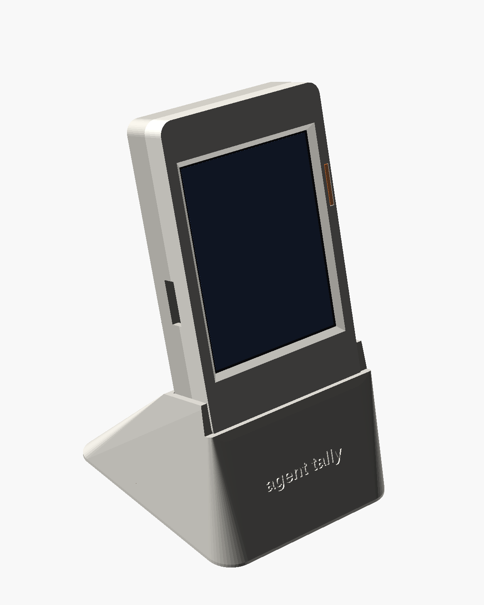
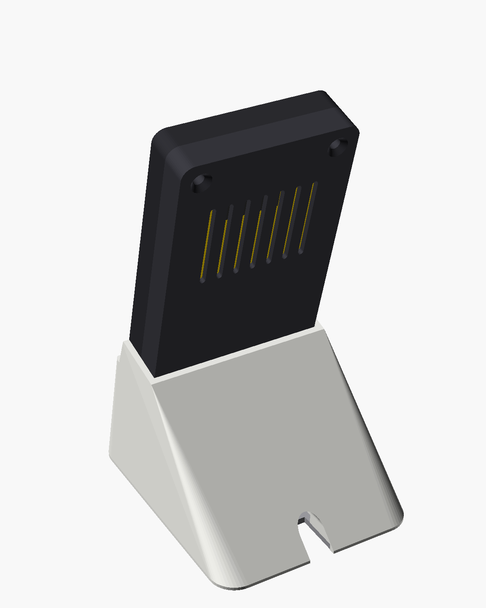

# AgentTally stand

A portrait case and desk stand for the 2.8" Cheap Yellow Display (ESP32-2432S028R, both the micro-USB and the dual-USB version). The screen leans back 15°, and the USB plug and cable hide inside the foot.

 

## Parts

| File | Print orientation | Notes |
|---|---|---|
| `stl/agenttally-cyd28-front.stl` | face down | bezel with the screen window |
| `stl/agenttally-cyd28-back.stl` | outside down | rear cover, vents let the RGB LED glow through |
| `stl/agenttally-cyd28-stand.stl` | upright | ≥30% infill: the weight keeps it from tipping when you press the resistive screen |
| `stl/agenttally-cyd28-plate.stl` | flat | closes the cable tunnel, recesses for 8 mm rubber feet |
| `stl/agenttally-cyd28-light_pipe.stl` | on its side, as exported | **clear PETG** (brightest) or **white PLA** (softer, neutral colour). 100% infill, 0.12–0.16 mm layers, slow outer walls |

No supports needed (the cable tunnel is a 12 mm bridge). 0.2 mm layers, PLA or PETG.

**Hardware:** 4× M3×14 countersunk screws (they thread into the bezel posts), optional 4× 8 mm rubber feet, a USB-A to micro-USB or USB-A to USB-C data cable.

## Status light

The board's RGB LED sits on the back, so normally you can't see it from the front. The `light_pipe` part carries its light to a 12 mm light bar on the right edge of the bezel:

1. A 45° face right behind the LED reflects its light sideways (total internal reflection, no paint needed).
2. The bar runs behind the PCB to the right edge, where a second 45° face turns it forward.
3. It climbs a groove inside the right wall, past the PCB and the display, and ends flush in a slot in the bezel.

The firmware drives the LED for every state: **red breathing** = needs you, **steady green** = done, **slow amber** = working, off = idle.

The LED position (`led_xy`) was measured from a photo of one dual-USB board (±1.5 mm), the bar is 5 mm wide to tolerate that. Coloured transparent filament tints the light: orange PETG passes red well but makes green look yellow.

## Assembly

1. Lay the board face down in the front bezel. The USB port goes to the bottom, the end with the wider bezel.
2. Slide the light pipe's thin leg down the groove in the right wall until its shoulder stops and the tip sits flush in the bezel slot. Its long arm now lies across the back of the board, with the angled end over the RGB LED.
3. Put the rear cover on (its two pins press the pipe against the board) and drive the four M3 screws through it and the board into the bezel posts. Stop when they are snug, the posts are plastic.
4. Push the cable up through the foot, from the bottom opening into the socket, and plug it into the board.
5. Seat the body in the socket. Press the cable into the tunnel along the bottom of the foot so it leaves through the notch at the back.
6. Press the plate into the recess under the foot and add rubber feet.

## Customising

Open `agenttally.scad` in OpenSCAD (2024 or newer, or MakerWorld's Parametric Model Maker). Useful parameters:

| Parameter | Default | |
|---|---|---|
| `board` | `cyd28` | `cyd35` is a 3.5" preset with **estimated** dimensions |
| `tilt` | 15 | screen lean in degrees |
| `plug_room` | 34 | space below the board for the plug and its bend. About 16 with a 90° USB cable or adapter, which makes the whole stand much lower |
| `foot_depth` | 80 | footprint depth |
| `clear`, `fit` | 0.4, 0.25 | clearances around the PCB and between the body and the socket |
| `touch_gap` | 0.3 | gap between the bezel and the resistive touch film. Pressing on the film edge causes phantom touches |

`render.sh` exports all STLs and the preview images. It uses `openscad` from your PATH, `$OPENSCAD`, or a Docker image.

## Status

Designed from the Sunton drawing, the display datasheet and existing enclosures (see [docs/HARDWARE.md](../docs/HARDWARE.md)), but **not printed yet**. If you print it, please open an issue with how it fit.

Licensed [CC BY 4.0](LICENSE).
