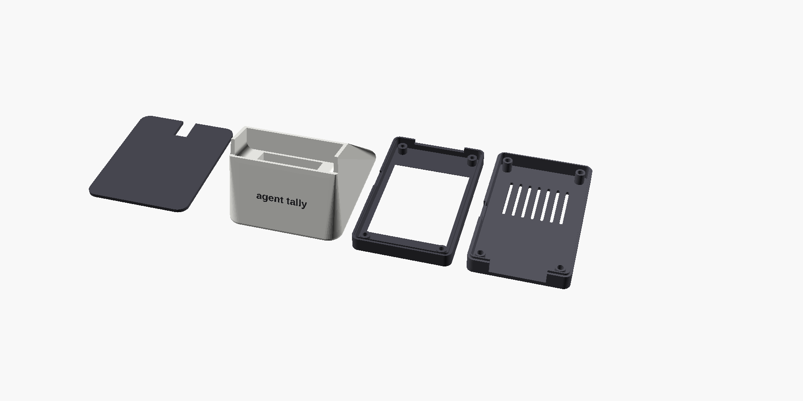
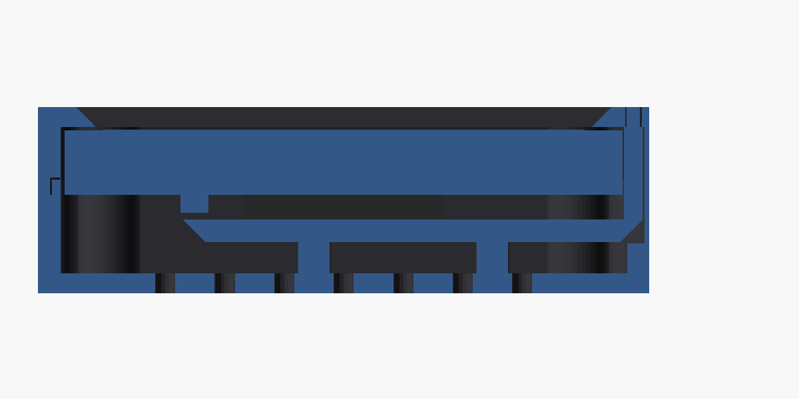
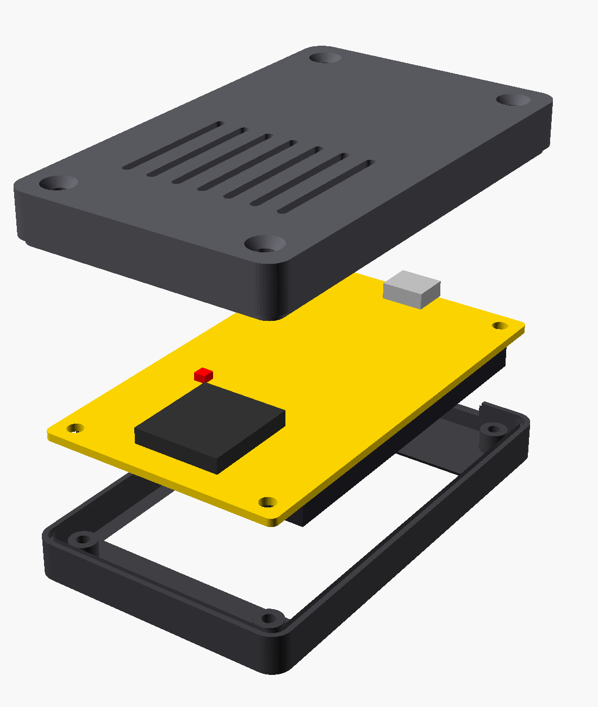

# AgentTally stand

A portrait case and desk stand for the 2.8" Cheap Yellow Display (ESP32-2432S028R). The screen leans back 15°, and the USB plug and cable hide inside the foot.

 


## Status

- **2.8" (`cyd28`): printed and in daily use.** Black body, white stand with inlaid letters, PLA, Bambu Lab A1 mini. Fitted to the board with two USB ports (micro-USB + USB-C). The micro-USB-only board has the same outline and mounting holes, but that fit has not been checked.
- **3.5" (`cyd35`): not printed.** The dimensions are estimates. The STLs are in `stl/` for anyone who wants to try, expect to adjust them.
- **Light pipe: experimental, not in the default parts.** The unit in daily use was printed with it (translucent PETG), but the light is too dim to be useful; the firmware alerts on the screen instead. The default bezel and rear cover are now the same parts without the light pipe slot and pins. That is the only difference, but the slot-free version itself has not been printed yet. The original parts with the slot are kept as `*-lightpipe.stl`, see [Status light](#status-light-experimental).

If you print it, please open an issue with how it fit.

## Parts



| File | Print orientation | Notes |
|---|---|---|
| `stl/agenttally-cyd28-front.stl` | face down | bezel with the screen window |
| `stl/agenttally-cyd28-back.stl` | outside down | rear cover with vents |
| `stl/agenttally-cyd28-plate.stl` | flat | closes the cable tunnel, recesses for 8 mm rubber feet |

Pick one stand (all upright, at least 30% infill: the weight keeps it from tipping when you press the screen):

| Stand | Files | |
|---|---|---|
| Name in a second colour | `stand.stl` + `stand_text.stl` | needs an AMS or a filament change. Load `stand_text.stl` as a part of the stand object so the letters stay in place |
| Name engraved, one colour | `stand.stl` | the name is a 0.6 mm engraving |
| No lettering, one colour | `stand-plain.stl` | plain front |

Experimental, only if you want to try the light pipe (see [Status light](#status-light-experimental)): `front-lightpipe.stl` and `back-lightpipe.stl` replace the bezel and the rear cover, plus `light_pipe.stl` (on its side, as exported).

The STLs are already in print orientation. No supports.

**Hardware:** 4× M3×14 countersunk screws (they cut their own thread in the bezel posts, longer ones bottom out), a USB-A to USB-C or USB-A to micro-USB data cable, optional 4× 8 mm rubber feet.

## Print settings

These are the settings of the Bambu Studio project that `bambu/make_3mf.py` builds. Times and weights are Bambu Studio 2.9.1 estimates for an A1 mini with a 0.4 mm nozzle, not measurements.

| Plate | Parts | Settings | Time | Filament |
|---|---|---|---|---|
| 1 Body | bezel, rear cover, bottom plate | 3 walls, 15% infill | 1 h 00 min | 33 g |
| 2 Stand, 2 colours | stand with inlaid letters (needs an AMS) | 4 walls, 40% gyroid | 3 h 42 min | 86 g (83 g stand colour, 3 g letters, including the prime tower and purge) |
| 3 Stand, 1 colour | stand, name engraved | 4 walls, 40% gyroid | 2 h 40 min | 69 g |
| 4 Stand, no lettering | plain stand | 4 walls, 40% gyroid | 2 h 40 min | 69 g |

All plates: PLA, 0.2 mm layers, no supports, stock presets (`0.20mm Standard @BBL A1M`, `Bambu PLA Basic @BBL A1M`). Print plate 1 and one of plates 2 to 4. Only PLA has been tested; plate 2 is the one that was printed, plates 3 and 4 have not been.

```sh
python3 bambu/make_3mf.py   # needs Bambu Studio, writes the projects to print/
```

The `print/` folder is not in the repository. The script arranges and slices the plates with the Bambu Studio command line, using only system presets. Walls and infill are set per object. Two experimental projects are written next to it: `agenttally-experimental-lightpipe-body.3mf` (bezel and rear cover with the slot, plus the bottom plate, 1 h 01 min, 33 g) and `agenttally-experimental-lightpipe.3mf` (two light pipes in translucent PETG, 0.12 mm layers, 100% infill, 19 min, 1.3 g).

## Status light (experimental)

This is how the first unit was built, but the light is too weak, so it is no longer part of the default design. To build it, print `front-lightpipe.stl`, `back-lightpipe.stl` and `light_pipe.stl` (or set `light_pipe = true` in `agenttally.scad`).

The board's RGB LED sits on the back, so you can't see it from the front. The `light_pipe` part carries its light to a 12 mm light bar on the right edge of the bezel. In practice the bar glows too weakly to notice in daylight, so treat it as an experiment. Without it the LED still shines through the vents onto the wall behind.



1. A 45° face right behind the LED reflects its light sideways (total internal reflection, no paint needed).
2. The bar runs behind the PCB to the right edge, where a second 45° face turns it forward.
3. It climbs a groove inside the right wall, past the PCB and the display, and ends flush in a slot in the bezel.

The firmware drives the LED for every state: **red breathing** = needs you, **steady green** = done, **slow amber** = working, off = idle.

The LED position (`led_xy`) was measured from a photo of one dual-USB board (±1.5 mm), the bar is 5 mm wide to tolerate that. Coloured transparent filament tints the light: orange PETG passes red well but makes green look yellow.

Material: translucent PETG at 0.12 mm layers and 100% infill is what was tested. White PLA is untested.

## Assembly



1. Lay the board face down in the front bezel. The USB port goes to the bottom, the end with the wider bezel.
2. Only with the experimental light pipe parts: slide the pipe's thin leg down the groove in the right wall until its shoulder stops and the tip sits flush in the bezel slot. Its long arm then lies across the back of the board, with the angled end over the RGB LED. Two pins in the rear cover hold it down.
3. Put the rear cover on and drive the four M3 screws through it and the board into the bezel posts. Stop when they are snug, the posts are plastic.
4. Push the cable up through the foot, from the bottom opening into the socket, and plug it into the board.
5. Seat the body in the socket. Press the cable into the tunnel along the bottom of the foot so it leaves through the notch at the back.
6. Press the plate into the recess under the foot and add rubber feet.

## Customising

Open `agenttally.scad` in OpenSCAD (2024 or newer, or MakerWorld's Parametric Model Maker). Useful parameters:

| Parameter | Default | |
|---|---|---|
| `board` | `cyd28` | `cyd35` is a 3.5" preset with **estimated** dimensions, not printed |
| `label` | `agent tally` | the text on the front of the stand, `""` for none |
| `light_pipe` | `false` | `true` adds the experimental light pipe slot in the bezel and the pins in the rear cover |
| `tilt` | 15 | screen lean in degrees |
| `plug_room` | 34 | space below the board for the plug and its bend. About 16 with a 90° USB cable or adapter, which makes the whole stand much lower |
| `foot_depth` | 80 | footprint depth |
| `clear`, `fit` | 0.4, 0.25 | clearances around the PCB and between the body and the socket |
| `touch_gap` | 0.3 | gap between the bezel and the resistive touch film. Pressing on the film edge causes phantom touches |

`render.sh` exports all STLs and the preview images. It uses `openscad` from your PATH, `$OPENSCAD`, or a Docker image.

Licensed [CC BY 4.0](LICENSE).
